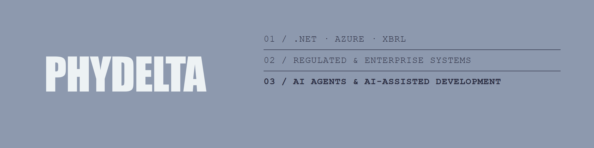
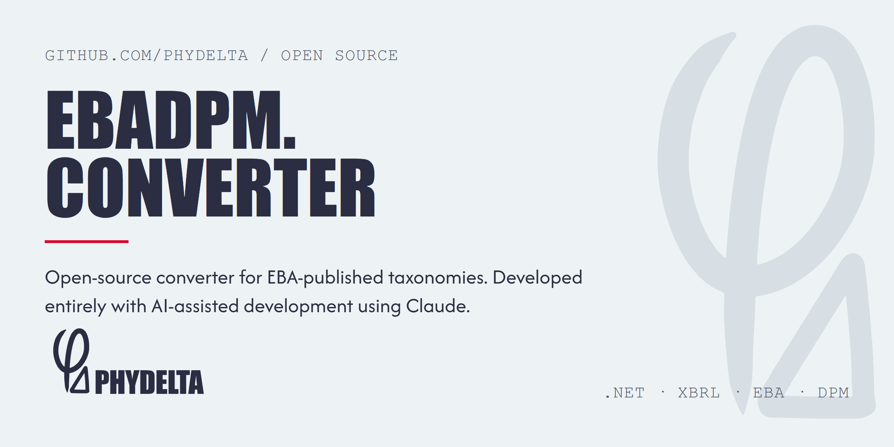

<picture>
  <source media="(prefers-color-scheme: dark)" srcset="assets/GitHub_Profile-Header_1280x320_Night@2x.png">
  
</picture>

**DEPENDABLE SOFTWARE. AHEAD OF THE CURVE.**

Phydelta is the personal brand of Jose Luis Martín, a freelance senior software engineer and solution architect (.NET, Azure, XBRL) who delivers dependable software for regulated and enterprise environments and applies current AI agents and AI-assisted development in practice.

## Open source

<a href="https://github.com/phydelta/EbaDpm.Converter">
  <picture>
    <source media="(prefers-color-scheme: dark)" srcset="assets/GitHub_Social-Preview_EbaDpm-Converter_1280x640_Night@2x.png">
    
  </picture>
</a>

**[EbaDpm.Converter](https://github.com/phydelta/EbaDpm.Converter)**: converts the EBA DPM Database from Microsoft Access to SQLite in the DPM distribution schema. Supports DPM 1.0 and DPM 2.0, with built-in validation.

## Values

- **Reliability.** Software that keeps running.
- **Precision.** Attention to detail in regulated work.
- **Pragmatism.** Practical results over theory.
- **Continuous learning.** Testing the state of the art.
- **Openness.** Open-source work, code and demos on request.

## Contact

[cv.phydelta.net](https://cv.phydelta.net) · [LinkedIn](https://www.linkedin.com/in/jlmp/) · [X](https://x.com/phydelta)
